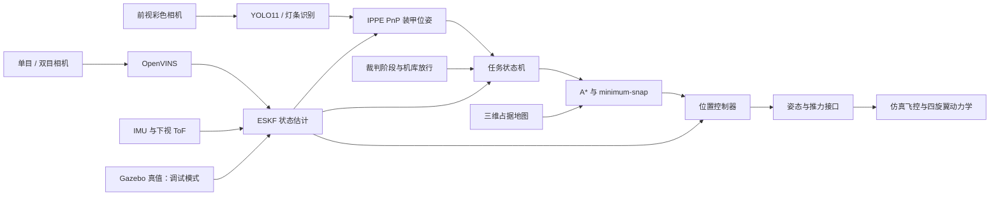

# RM27 DRONE

面向 **RoboMaster 2027 超级对抗赛空中机器人**的视觉定位与自主导航系统。基于 ROS 2 Humble、Gazebo Classic 11 和 C++，用于先在仿真中验证感知、定位、规划与飞行控制，再向实机迁移。

赛事中的空中系统由空中机器人与机库组成，承担攻击和侦察任务。本项目当前聚焦**单机起飞、导航、识别敌方普通装甲、冲击、撤离和降落**，不包含完整多机调度与赛事机库通信。

[快速开始](#快速开始) · [系统架构](#系统架构) · [运行模式](#运行模式) · [视觉识别](docs/vision.md) · [仿真场景](docs/simulation.md) · [来源与许可](docs/credits.md)

## 系统架构



| 模块 | 当前实现 |
|---|---|
| 视觉感知 | YOLO11 敌方基地/前哨站关键点识别，可切换传统灯条；共用 PnP 与图像时刻位姿转换 |
| 状态估计 | 单目/双目 OpenVINS + ESKF，融合 IMU、ToF；支持独立真值调试模式 |
| 轨迹规划 | 膨胀三维占据栅格 A*、7 次多项式 minimum-snap |
| 飞行控制 | 位置环输出姿态和归一化推力，仿真内环跟踪；另有可选 PX4 桥 |
| 任务与约束 | 起飞、巡航、搜索、冲击、撤离、降落；裁判放行、估计健康检查、电子围栏和急停 |
| 场景 | 约 28 m × 15 m 场地，基地、固定前哨站、静止能量机关、飞镖移动靶与机库 |

`map` 使用 ENU，原点位于场地中心，+x 指向蓝方。视觉输入是彩色相机，VIO 使用独立的单目/双目灰度流。

## 快速开始

环境：Ubuntu 22.04 / WSL2、ROS 2 Humble、Gazebo Classic 11、OpenVINO C++ Runtime。当前提供的 YOLO 后端使用 OpenVINO CPU 推理。

### 1. 准备依赖

在已有 ROS 2 Humble 的环境中：

```bash
sudo apt install \
  ros-humble-gazebo-ros-pkgs ros-humble-xacro \
  ros-humble-robot-state-publisher ros-humble-rviz2 \
  ros-humble-rqt-image-view ros-humble-image-transport-plugins \
  ros-humble-cv-bridge python3-colcon-common-extensions \
  python3-numpy python3-pil libopencv-dev libeigen3-dev libyaml-cpp-dev xvfb
```

安装 [OpenVINO C++ Runtime](https://docs.openvino.ai/2026/get-started/install-openvino.html) 并加载其环境；已有安装时使用对应的 `setupvars.sh`。CMake 需要能找到 `OpenVINOConfig.cmake`，配置方法见[视觉接入文档](docs/vision.md#依赖与构建)。

### 2. 初始化并编译

以下命令从仓库根目录执行：

```bash
git submodule update --init --recursive
source /opt/ros/humble/setup.bash
cd ws
colcon build --symlink-install --cmake-args -DCMAKE_BUILD_TYPE=Release \
  --packages-skip ov_eval ov_data
source install/setup.bash
cd ..
```

`ov_eval`、`ov_data` 为 OpenVINS 评测工具及示例数据。场景和 YOLO11 模型已包含在项目中，无需每次启动时重新生成或复制。

### 3. 启动查看

```bash
./sim.sh auto_start:=false
```

打开 Gazebo、RViz 与视觉调试窗口，保持准备状态。软件渲染使用锁步保证相机与物理时间一致，主机性能不足时仿真会慢于实际时间。默认使用传统灯条识别，保留当前仿真任务效果。YOLO11 已接入，可通过 `detector:=yolo` 启用，模型使用本仓库中的副本。启动仿真前需要完成上面的编译。

自动任务与视觉验收：

```bash
./sim.sh                          # 真值定位，自动执行仿真任务
./sim.sh mono allow_blind_attack:=false   # 单目 VIO，冲击前要求视觉确认
./sim.sh stereo allow_blind_attack:=false # 双目 VIO，冲击前要求视觉确认
```

默认仿真裁判已设为比赛开始和机库放行。调试模式允许按地图已知目标进行盲冲击；**验证 YOLO 是否实际参与任务时，应显式使用 `allow_blind_attack:=false`**。模型是否能识别某个仿真视角需通过图像验证，不能用默认任务飞完作为识别成功的依据。

## 运行模式

| 用法 | 定位来源 | 适用场景 |
|---|---|---|
| `./sim.sh` / `./sim.sh gt` | 仿真真值，关闭 VIO | 控制、轨迹与场景调试 |
| `./sim.sh mono` | 单目 OpenVINS + ESKF | 单目视觉惯性定位验收 |
| `./sim.sh stereo` | 双目 OpenVINS + ESKF | 双目视觉惯性定位验收 |
| `./sim.sh off` | ESKF，不启 VIO、不用真值 | IMU / ToF 与估计器调试 |

识别后端与定位模式独立：`mono` / `stereo` 指 VIO，不代表 YOLO 开关。视觉模式要求健康的 VIO 估计；与所选模式矛盾的真值参数会使启动失败。

| 参数 | 用途 | 默认 |
|---|---|---|
| `team:=red/blue` | 本方队伍、机库起点与敌方颜色 | `red` |
| `target:=auto` | 自动选择，或指定如 `blue_outpost_armor_0` | `auto` |
| `detector:=yolo/traditional` | YOLO11 / 传统灯条识别 | `traditional` |
| `auto_start:=false` | 等待手动任务启动 | `true` |
| `allow_blind_attack:=false` | 冲击前必须获得视觉确认 | `auto`，当前仿真模式允许 |
| `gui:=false rviz:=false imshow:=false` | 关闭图形界面 | 均为 `true` |

例如，仅启用后端服务：

```bash
./sim.sh gui:=false rviz:=false imshow:=false auto_start:=false
```

手动启动或急停，在另一个加载 `ws/install/setup.bash` 的终端执行：

```bash
ros2 topic pub --once /drone/mission/start std_msgs/msg/Empty '{}'
ros2 topic pub --once /drone/estop std_msgs/msg/Bool '{data: true}'
```

## 代码与接口

| 功能包 | 职责 |
|---|---|
| `rm_drone_msgs` | 装甲、轨迹、姿态设定、裁判和任务消息 |
| `rm_drone_vision` | YOLO11 / 灯条识别、PnP、视觉调试图像 |
| `rm_drone_estimator` | ESKF、OpenVINS 标定与运行配置 |
| `rm_drone_planner` | 占据栅格、轨迹生成、任务状态机和模拟裁判 |
| `rm_drone_control` | 位置控制、仿真飞控及可选 PX4 桥 |
| `rm_drone_description` | 无人机模型与传感器定义 |
| `rm_field_gazebo` | 场地模型、材质、世界和规划地图生成器 |
| `rm_drone_gazebo_plugins` | 动力学、装甲冲击与场地机构插件 |
| `rm_drone_bringup` | 系统启动与 RViz 配置 |
| `open_vins` | 上游 VIO 子模块，固定版本见[来源说明](docs/credits.md) |

| ROS 接口 | 内容 |
|---|---|
| `/drone/color/image_raw`、`/drone/color/camera_info` | 识别原始图像与内参 |
| `/drone/armors` | 装甲类别、关键点、相机位姿及有效时的 map 位姿 |
| `/drone/odom` | 估计器输出 |
| `/drone/vision/debug_image` | 检测框、关键点、PnP 结果和推理耗时 |
| `/drone/mission_state` | 任务阶段与状态 |
| `/drone/setpoint`、`/drone/attitude_target` | 轨迹和姿态控制接口 |

## 当前边界与实机迁移

规则依据是本地 2027 V1.0.0 两份 PDF。无人机冲击对象仅为敌方基地和前哨站普通装甲；飞镖移动靶、能量机关和机库不属于其冲击目标。场景采用 2026 网格和规则尺寸近似布置，不能作为官方 2027 CAD 或测量基准。

当前是单机仿真开发系统。尚未实现完整四机协作、侦察回传、实机机库通信和正式裁判协议，也未完成实机飞行验证。已确认现有 YOLO11 能运行本地真实录像，但在当前 Gazebo 基地/前哨站近景中出现低置信度及熄灭类别误判，默认 0.7 门限下未获得有效装甲输出。YOLO 模式用于接入验证与后续场景适配，尚不能代替默认检测器。

迁移实机需要替换相机/IMU/ToF 驱动、用 Kalibr 标定外参、验证机载推理性能，并配置 PX4/uXRCE-DDS 及 `px4_msgs`。`sim.sh` 仅用于仿真。

## 文档与许可

- [视觉推理、模型类别与配置](docs/vision.md)
- [地图格式、配色、场地生成与道具调试](docs/simulation.md)
- [第三方模型、算法引用与许可证](docs/credits.md)

自研 `rm_*` 源码使用 [MIT](LICENSE)；OpenVINS、第三方模型与纹理遵循各自许可，详见来源说明。
