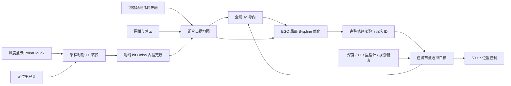

# 在线建图与 EGO 局部规划

[返回系统介绍](../README.md)

系统默认使用 EGO-Planner 进行局部轨迹优化，在线地图在有限场地范围内累计占据，不进行回环检测或全局 SLAM。比赛任务仍由 `mission_node` 选择目标并执行起飞、巡航、视觉确认、冲击、撤离和降落；EGO 接收巡航目标，输出 B-spline。任务节点在 50 Hz 控制循环中计算设定点，是 `/drone/setpoint` 的唯一发布者。

算法来源：[ZJU-FAST-Lab/ego-planner-swarm](https://github.com/ZJU-FAST-Lab/ego-planner-swarm)，官方 `ros2_version` 分支，固定提交 `23a8d5a191711dd65633df689bd00f55d4dea8f9`。代码、GPL-3.0 许可和适配修改见 [rm_ego_planner/SOURCE.md](../ws/src/rm_ego_planner/SOURCE.md)。本项目接入的是其实际 B-spline 优化核心；点云融合、任务接口与健康保护由本项目实现，不使用上游的模拟飞控。

## 数据流



## 启动

完成编译后，从仓库根目录执行：

```bash
./sim.sh auto_start:=false  # 查看在线地图和规划状态
./sim.sh                   # 默认双目VIO + EGO + 自动比赛任务
./sim.sh gt mission_mode:=single  # 显式真值与单次接触对照
./sim.sh stereo allow_blind_attack:=false  # 同时验收视觉定位与视觉确认
```

`planner:=astar` 显式切回原有静态 A* + minimum-snap 作对照；没有 EGO 点云输入或规划失败时，系统不会自动切换成静态规划继续飞行。EGO 模式禁止 `use_depth:=false`。

EGO 真值调试沿用异步仿真调度；图像时刻 TF 与新鲜度门限用于拒绝落后于物理时间的点云。视觉定位默认使用锁步调度，也可显式设置 `lockstep:=false`；软件渲染速度不足时会触发深度健康保护。Gazebo、RViz、双目、彩色、深度、点云和 imshow 的显示开关保留；新的在线障碍与局部轨迹通过原 `Plan` 显示层发布，不修改 RViz 布局。

## 点云融合

输入为 `/drone/depth/points`；可通过 `depth_topic:=/实际驱动/points` 改接驱动或测试中继。点云需提供 float32 的 `x/y/z` 字段，支持行填充和有组织点云。当前实现拒绝大端数据、无效字段、过期或回退的时间戳；无效或空观测不会刷新地图健康时间。

点云根据消息采样时间查询 TF，转换到 `map`。射线起点由物理传感器坐标系 `sensor_frame` 确定，默认 `depth_optical`；实机必须改成真实相机光学系并完成外参标定。缺少该时刻 TF 时暂存最新帧等待，不用最新姿态代替旧图像姿态。TF 仍未到齐且点云过期后，按断流处理。

每个体素每帧只累计一次 hit/miss 证据；同帧 hit 优先于穿过它的 free ray，避免稠密点云反复增加置信度。命中更新障碍，穿过的自由空间射线清除旧占据。视野外没有被重新观测到的障碍继续保留，不按计时自动消失。NaN 深度不能作为自由空间证据。

静态几何先验与在线层分开管理：静态 CAD 障碍、围栏和禁区不会被自由射线擦除。在线层负责补充未建模障碍，并在观察到自由空间后清除其旧位置。修改真实赛场布局时，应更新几何先验或关闭巡航几何先验，不能指望在线层删除旧 CAD 建筑。

`map_prior:=false` 关闭巡航区域的 CAD 几何先验，未知区域按占据处理；已标定的机库起飞区域、起飞结构、围栏和禁区配置仍保留。全局路径只作为导向，EGO 局部轨迹必须处于已知自由空间；远处目标未进入视野不要求整条路线预先建图。没有观察到可通行走廊时等待，不实现主动探索或自主寻找未知起降点。

## 规划与保护

局部目标由组合地图上的 A* 导向路径选取，默认前视路径长度约 2.2 m。EGO 进行反弹碰撞优化与 B-spline 时间调整，输出带任务请求 ID、轨迹版本和地图版本的消息。发布前检查完整轨迹的碰撞、有限数值、速度、加速度与规划耗时；任务节点接收时再次检查消息结构、任务 ID、时间和静态约束。只在校验通过后采用新轨迹。

默认每 0.25 s 重新规划；发现旧轨迹前方有新障碍会提前尝试重规划。停止距离内出现障碍时，先通知任务层刹停，再进行优化。前视相机需要看到行进方向，因此巡航时飞机朝向跟随运动方向；抵近目标后转向装甲。

以下情况进入刹停保护，稳定后保持位置，条件恢复后重新规划：

- 深度超过 0.5 s 未得到有效融合，或图像时刻 TF 持续缺失。
- EGO 状态心跳超时、旧轨迹到期且没有新轨迹。
- 预测停止距离内出现在线障碍，或当前局部轨迹被标记为阻塞。

里程计断流、定位失效、电子围栏和急停沿用任务及控制层原有保护。世界时间回退后清除在线地图、旧轨迹和任务请求，回到未起飞状态。暂停时不因墙钟流逝累计传感器断流。

起飞、冲击和撤离仍使用任务层的专用导引；动态占据的近距保护同样生效。EGO 不负责把目标装甲当普通障碍绕开，也不接管裁判和机库许可。

## 参数与话题

核心参数位于 `ws/src/rm_ego_planner/config/ego.yaml`：

| 参数 | 默认 | 作用 |
|---|---|---|
| `resolution` | 0.1 m | 占据栅格分辨率 |
| `obstacle_margin` | 0.14 m | 障碍膨胀，在线层额外考虑体素尺寸 |
| `local_horizon` | 2.2 m | 局部目标前视路径长度 |
| `replan_period` | 0.25 s | 周期重规划间隔 |
| `planning_budget` | 0.20 s | 单次规划耗时预算 |
| `max_speed` / `max_acceleration` | 1.2 m/s / 2.0 m/s² | 发布轨迹的整段运动约束 |
| `sensor_timeout` / `odom_timeout` | 0.5 s / 0.3 s | 数据新鲜度门限 |
| `cloud_max_range` / `max_rays` | 6 m / 6000 | 每帧映射距离与硬射线预算 |
| `sensor_frame` | `depth_optical` | 物理深度传感器坐标系 |

launch 的 `depth_rate:=auto` 在 EGO 模式取 20 Hz、静态 A* 模式取 5 Hz，也可显式设置 1–30 Hz。EGO 模式的巡航速度、加速度和刹车参数与局部规划限制同步覆盖；实机需按感知距离、测量延迟与制动能力重新验收。

| 话题 | 内容 |
|---|---|
| `/drone/ego/goal` | 任务目标与取消请求 |
| `/drone/ego/trajectory` | 校验后的局部 B-spline |
| `/drone/ego/status` | 地图健康、阻塞状态、点云年龄、任务和地图版本 |
| `/drone/ego/occupancy` | 在线观测障碍，`map` 坐标系 PointCloud2 |
| `/drone/planner/markers` | EGO 局部轨迹与在线障碍，复用 RViz `Plan` |

## 实机边界

当前动态避障采用持续观测、重规划和刹停响应，没有估计其他机器人的速度或预测其未来轨迹，也不是多机 EGO-Swarm 协作。相机视场外、遮挡后和量程外的目标仍受传感器限制；突然近距离闯入的物体不保证能避开。

板端只部署传感器驱动、定位、任务、EGO 与控制接口，Gazebo/RViz 留在电脑。局部 A* 工作池限制为 60×60×40，映射射线数量有上限；仍需在实际 A733 板上测量规划延迟、CPU/内存、温度和控制周期，不能把桌面仿真速度当作板端性能。

## 仿真验证记录

2026-10-25 在当前工作空间完成以下检查，均通过；这不是 A733 板端或实机验收。

| 检查 | 结果 |
|---|---|
| 占据地图与 B-spline 基础检查 | 命中、膨胀、自由射线清除、未观测障碍保留、地图重置、未知占据及非法节点向量检查通过 |
| ROS 点云与重规划 | 对旋转传感器坐标系正确做采样时刻转换；加入障碍后生成绕行曲线，移开后清除旧占据 |
| 输入故障 | 过期点云、缺失 TF、缺少 XYZ 字段、全 NaN 点云均不刷新地图健康，恢复有效输入后可重新规划 |
| 不使用巡航 CAD 先验 | 能通过可见自由走廊朝远处已知任务目标生成局部轨迹；没有宣称具备未知环境主动探索 |
| Gazebo 完整链路 | 红蓝两侧均从机库起飞进入 EGO 巡航；设定点话题只有任务节点发布；双目、彩色、深度、点云与视觉调试话题均保留 |
| 深度断流与恢复 | 保持仿真时间推进，仅中断点云中继，任务进入 BRAKE 并降至低速；恢复后重新规划进入巡航 |
| 场景临时物体 | 将未写入 CAD 的物体加入并移动，实际深度点云将其写入在线地图，规划和健康保护继续响应 |
| 世界重置 | 时钟回退后回到 IDLE、停桨并取消旧 EGO 请求 |
| 静态规划对照 | 原有 plan_test 在当前新地图上通过，静态后端保留为显式选择 |


## 有限任务、返航和降落

默认`mission_mode=match`：压缩准备/自检、五秒倒计时后进入420秒比赛，最后60秒预留返航。
`max_attacks=0`表示在该时间窗内重复执行，正数才表示固定接触配额；连续三次未确认接触才按重试耗尽返航，成功接触清零连续失败数，总尝试数单独显示。每轮撤离到观察点后重新累计五帧视觉确认。
比赛阶段/许可失效、目标血量归零、时间预算或操作指令也能触发返航；返航预算仍为150秒。
`mission_mode=single`保留一次接触后返航的验收行为、300秒任务预算。比赛时间由仿真裁判发布，任务节点不使用墙钟推测比赛已开始。
BRAKE进入时固定三维悬停锚点，保留位置反馈并平滑减小惯性减速度，避免每周期移动设定点导致返航前持续掉高；速度及深度地图恢复条件仍需满足才继续规划。
视觉确认默认使用五个连续图像时间戳，间隔超过0.3秒会重新累计，同帧多个框不重复计数。
目标关联同时约束敌方颜色、种类、小/大装甲、位置与三维法向。搜索失败可返回，不记作接触成功。
`/drone/mission/return`（std_msgs/Empty）可请求返航；末段先撤离再返航。

返航仍使用同一 EGO 接口；已在目标附近时直接进入对中，不等待零长度样条。
下视相机识别原生彩色八边形 H 平台，用同步RGB-D和图像时间的TF求水平误差；低高度外圈离开画面后
短暂跟踪H字样，有效图像始终更新对中。相邻图像中的平台相对位移估计相对速度，用1秒时间常数估计并抵消VIO的缓慢速度偏差；控制器保留高频惯性速度阻尼，避免直接差分图像噪声引起振荡。
最后8厘米只在最近一秒仍有有效相对速度时短暂延续对中。底部真实支撑持续0.4秒后，结合平台相对横向速度与新鲜IMU静止检查确认停桨；应急降落仍保留估计速度判据。
仅在己方机库12厘米降落圆柱内允许接近该支撑面，不豁免能量机关、其他机库或禁区。
下降设定点限制在支撑面下15毫米以内，与碰撞许可一致，避免相对高度控制越过许可范围而被旧悬停点替换。
图像消失时停止高位下降并报告原因，不能把无图像当作零误差。

允许接触的末段会发布短时有效的 `/drone/ego/contact_goal`；仅放行目标板附近的小范围接触区，
并把接近方向的制动检测截断到目标平面。其他动态障碍、深度新鲜度和电子围栏仍检查。
末段被保护打断后先刹停，再恢复撤离，不会重置为下一次攻击。


固定装甲可提供绝对平移校正：匹配颜色/类别/尺寸/三维法向，要求近距离、高置信度、低重投影误差及
连续一致观测；每帧校正限制2厘米，并同步更新VIO到map的平移。累计坐标变化超过10厘米时清理旧的
在线占据历史，保留CAD先验并等待新观测。原始VIO误差与融合结果分别报告，不将地标校正后的结果称为纯VIO。

高度增加模拟气压传感器，输出带噪声、偏置漂移的标准大气压力，在停靠初始化阶段标定高度零点。
下视RGB-D根据H平台中心像素的实际深度计算偏移和绝对位置，避免单点ToF光束落到平台外地面时误判高度。
气压、固定装甲及H平台均为传感器/已知地图观测；导航节点不读取仿真位姿作为这些校正值。
位置控制器直接监控估计健康，失效持续0.3秒后转入水平姿态下降，急停始终优先。


估计健康同时检查 OpenVINS 的相机更新心跳 `/ov_msckf/poseimu` 和已接受里程计，
仅有高频IMU外推不能维持 `vio_ok`。模拟相机20Hz、IMU/物理步500Hz，避免非整数采样调度。
左右目使用独立相机传感器，保留原来的图像话题和50毫米基线，TF与新的俯仰外参一致；RViz显示配置未修改。

ESKF保留有界的0.5秒IMU历史，将有效VIO位姿/速度传播到当前IMU时刻再更新，避免转弯时
将过去的姿态与当前状态直接比较。VIO先于对应IMU到达时只缓存最新一条，等待该采样时刻；
超过原有新鲜度范围、历史不完整或IMU间隔超过50毫秒时拒绝更新。传播增加相应过程噪声，
原有创新门限与失效保护保留，不因VIO拒绝更新而在飞行中重新初始化对齐关系。

固定装甲地标除平移外，还可提供绝对航向约束，解决长时间重复接近后仅靠平移校正仍会偏离返航位置的问题。
航向只使用`has_depth_normal=true`的静态装甲，保留类别、颜色、大小、置信度、距离、重投影及位置关联检查；要求倾角一致、水平法向足够可观测、偏航残差小于0.35rad且三次有效法向一致，相邻有效观测间隔不超过0.75秒；仅二维结果不会打断法向累计，平移校正仍使用独立的连续性检查。
单帧航向修正最多0.002rad，同步修正融合姿态、速度、协方差及VIO到地图的变换；位置围绕当前机体中心保持连续，再按地标位置作缓慢平移校正。
累计航向变化超过0.01rad时重建深度在线层，避免保留使用旧航向投影的障碍。它是已知视觉地标的受限校正，不使用仿真真值，也不绕过VIO健康检查。


巡航跟踪误差进入静态膨胀缓冲区时，任务可以先执行 `RECOVER`，再回到EGO规划。
恢复仅在低速、近水平姿态、定位及深度健康时尝试，距离不超过45厘米、速度不超过0.2m/s。
候选整段要求带1厘米余量的机身盒体不接触CAD实体，实体净空不减小，退出缓冲区后不再进入；
禁区、围栏和在线障碍制动继续生效。实体内或无法证明净空时保持保护，不能强行“脱困”。
CAD安全体积已覆盖的深度命中不在在线层重复膨胀，体积外的新障碍仍正常融合。

专用VIO双目下倾0.65rad（约37°），使地面特征更靠近相机，改善50毫米基线在远处平面上的弱视差；单/双目外参由同一配置生成器更新。前视彩色图像保持原朝向，使用独立的 `color_optical` 坐标系；两者不再共用错误的光学系。IMU插件在同一物理步结束时读取速度、角速度、姿态及时间，计算机体系比力并加入噪声，避免Classic异步LinkData速度与当前姿态不一致。只发布带噪声的加速度和角速度，不向上层导航发布模拟器位置或姿态。
IMU白噪声按密度/√dt离散，偏置随机游走按密度×√dt离散；默认固定种子2701，陀螺/加计噪声密度为0.001/0.01，偏置游走为0.00002/0.0004，单位见Kalibr约定。这些仍为仿真传感器假设，实机需重新标定。

双目静止初始化与起飞后的特征预算统一为120点；初始化的15点可用性、3像素静止视差及IMU静止门限不放宽，避免初始化阶段每目仅25点时长时间不足。

降落RGB-D配对后会等待该采样时刻的相机/机身TF，定时重试而不提前消费图像。H字样使用两处相对凹陷的几何结构识别，矩形不会作为H。完整彩色边框提供绝对XY地标；边框离开画面后，已标定字样延续相对对中。有效RGB-D同时提供已知平台上方的垂直高度，持续校正Z及VIO到map的高度平移，避免全局高度偏差与最后下降下限冲突；字样不提供新的绝对XY锚点。
连续有效字样观测会更新跟踪时间；超过1秒没有有效观测则停止延续，须重新看到完整边框。
避免缓慢下降时因边框已离开画面而错误丢弃仍然清晰可见的H标记。

OpenVINS仅在移动待处理图像时持有相机队列锁，特征跟踪和滤波计算在解锁后运行，减少IMU回调
被相机回调阻塞的风险。IMU发布、VIO和ESKF接收均使用200条有界缓冲；缓冲不替代采样时间及健康检查。

下视相机的光学裁剪与ROS深度过滤范围显式统一为0.01–4m，避免插件默认0.4m盲区。此范围是仿真传感器配置，实机需核对实际最近工作距离及近地测高方式。

EGO在测得状态接近有效旧轨迹时复用其初值；优化或完整校验失败后改用不同初值，失败重试受重规划周期限制，避免相同初值的无效重复计算。所有候选仍执行碰撞、速度、加速度及耗时校验。显式任务目标只允许敌方基地/前哨站普通装甲，友方和未知目标在启动时报错。

上游EGO的可行性限制按各坐标轴计算，任务和控制接口按三维向量范数计算。启动器将巡航速度、加速度的范数上限除以sqrt(3)后同时传入EGO管理器和优化器，保证各层口径一致；合速度/合加速度的最终校验仍保留。

`PlannerGoal.tolerance`定义允许的空闲终点半径：目标观察点20厘米、机库接近点40厘米，分别小于任务25/45厘米的到达判据。精确点被在线膨胀区覆盖时，EGO只在该区域内选择实际空闲点，不能删除障碍或把占据点追加到轨迹末尾；后续仍需视觉确认/平台对中，不能把接近点当成最终落点。节点参数`max_goal_tolerance`将请求半径限制在40厘米以内；消息`tolerance=0`要求精确目标。区域内无安全终点则报告失败并保持保护，整段样条仍执行完整碰撞检查。
