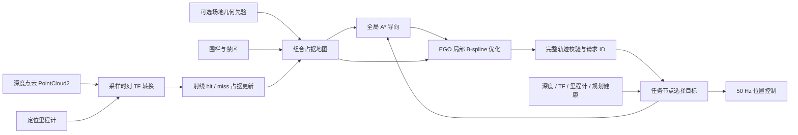

# 在线建图与 EGO 局部规划

[返回系统介绍](../README.md)

系统默认使用 EGO-Planner 进行局部轨迹优化，在线地图在有限场地范围内累计占据，不进行回环检测或全局 SLAM。比赛任务仍由 `mission_node` 选择目标并执行起飞、巡航、视觉确认、冲击、撤离和降落；EGO 接收巡航目标，输出 B-spline。任务节点在 50 Hz 控制循环中计算设定点，是 `/drone/setpoint` 的唯一发布者。

算法来源：[ZJU-FAST-Lab/ego-planner-swarm](https://github.com/ZJU-FAST-Lab/ego-planner-swarm)，官方 `ros2_version` 分支，固定提交 `23a8d5a191711dd65633df689bd00f55d4dea8f9`。代码、GPL-3.0 许可和适配修改见 [rm_ego_planner/SOURCE.md](../ws/src/rm_ego_planner/SOURCE.md)。本项目接入的是其实际 B-spline 优化核心；点云融合、任务接口与健康保护由本项目实现，不使用上游的模拟飞控。

## 数据流



## 启动

完成编译后，从仓库根目录执行：

```bash
./sim.sh auto_start:=false  # 查看在线地图和规划状态
./sim.sh                   # 默认 EGO + 15 Hz 深度点云，真值定位调试
./sim.sh stereo allow_blind_attack:=false  # 同时验收视觉定位与视觉确认
```

`planner:=astar` 显式切回原有静态 A* + minimum-snap 作对照；没有 EGO 点云输入或规划失败时，系统不会自动切换成静态规划继续飞行。EGO 模式禁止 `use_depth:=false`。

EGO 真值调试沿用异步仿真调度；图像时刻 TF 与新鲜度门限用于拒绝落后于物理时间的点云。视觉定位模式仍按原配置自动锁步，也可显式设置 `lockstep:=true`；软件渲染速度不足时会触发深度健康保护。Gazebo、RViz、双目、彩色、深度、点云和 imshow 的显示开关保留；新的在线障碍与局部轨迹通过原 `Plan` 显示层发布，不修改 RViz 布局。

## 点云融合

输入为 `/drone/depth/points`；可通过 `depth_topic:=/实际驱动/points` 改接驱动或测试中继。点云需提供 float32 的 `x/y/z` 字段，支持行填充和有组织点云。当前实现拒绝大端数据、无效字段、过期或回退的时间戳；无效或空观测不会刷新地图健康时间。

点云根据消息采样时间查询 TF，转换到 `map`。射线起点由物理传感器坐标系 `sensor_frame` 确定，默认 `depth_optical`；实机必须改成真实相机光学系并完成外参标定。缺少该时刻 TF 时暂存最新帧等待，不用最新姿态代替旧图像姿态。TF 仍未到齐且点云过期后，按断流处理。

每个体素每帧只累计一次 hit/miss 证据；同帧 hit 优先于穿过它的 free ray，避免稠密点云反复增加置信度。命中更新障碍，穿过的自由空间射线清除旧占据。视野外没有被重新观测到的障碍继续保留，不按计时自动消失。NaN 深度不能作为自由空间证据。

静态几何先验与在线层分开管理：静态 CAD 障碍、围栏和禁区不会被自由射线擦除。在线层负责补充未建模障碍，并在观察到自由空间后清除其旧位置。修改真实赛场布局时，应更新几何先验或关闭巡航几何先验，不能指望在线层删除旧 CAD 建筑。

`map_prior:=false` 关闭巡航区域的 CAD 几何先验，未知区域按占据处理；已标定的机库起飞区域、起飞结构、围栏和禁区配置仍保留。全局路径只作为导向，EGO 局部轨迹必须处于已知自由空间；远处目标未进入视野不要求整条路线预先建图。没有观察到可通行走廊时等待，不实现主动探索或自主寻找未知起降点。

## 规划与保护

局部目标由组合地图上的 A* 导向路径选取，默认前视路径长度约 2.2 m。EGO 进行反弹碰撞优化与 B-spline 时间调整，输出带任务请求 ID、轨迹版本和地图版本的消息。发布前检查完整轨迹的碰撞、有限数值、速度、加速度与规划耗时；任务节点接收时再次检查消息结构、任务 ID、时间和静态约束。只在校验通过后采用新轨迹。

默认每 0.25 s 重新规划；发现旧轨迹前方有新障碍会提前尝试重规划。停止距离内出现障碍时，先通知任务层刹停，再进行优化。前视相机需要看到行进方向，因此巡航时飞机朝向跟随运动方向；抵近目标后转向装甲。

以下情况进入刹停保护，稳定后保持位置，条件恢复后重新规划：

- 深度超过 0.5 s 未得到有效融合，或图像时刻 TF 持续缺失。
- EGO 状态心跳超时、旧轨迹到期且没有新轨迹。
- 预测停止距离内出现在线障碍，或当前局部轨迹被标记为阻塞。

里程计断流、定位失效、电子围栏和急停沿用任务及控制层原有保护。世界时间回退后清除在线地图、旧轨迹和任务请求，回到未起飞状态。暂停时不因墙钟流逝累计传感器断流。

起飞、冲击和撤离仍使用任务层的专用导引；动态占据的近距保护同样生效。EGO 不负责把目标装甲当普通障碍绕开，也不接管裁判和机库许可。

## 参数与话题

核心参数位于 `ws/src/rm_ego_planner/config/ego.yaml`：

| 参数 | 默认 | 作用 |
|---|---|---|
| `resolution` | 0.1 m | 占据栅格分辨率 |
| `obstacle_margin` | 0.14 m | 障碍膨胀，在线层额外考虑体素尺寸 |
| `local_horizon` | 2.2 m | 局部目标前视路径长度 |
| `replan_period` | 0.25 s | 周期重规划间隔 |
| `planning_budget` | 0.20 s | 单次规划耗时预算 |
| `max_speed` / `max_acceleration` | 1.2 m/s / 2.0 m/s² | 发布轨迹的整段运动约束 |
| `sensor_timeout` / `odom_timeout` | 0.5 s / 0.3 s | 数据新鲜度门限 |
| `cloud_max_range` / `max_rays` | 6 m / 6000 | 每帧映射距离与硬射线预算 |
| `sensor_frame` | `depth_optical` | 物理深度传感器坐标系 |

launch 的 `depth_rate:=auto` 在 EGO 模式取 15 Hz、静态 A* 模式取 5 Hz，也可显式设置 1–30 Hz。EGO 模式的巡航速度、加速度和刹车参数与局部规划限制同步覆盖；实机需按感知距离、测量延迟与制动能力重新验收。

| 话题 | 内容 |
|---|---|
| `/drone/ego/goal` | 任务目标与取消请求 |
| `/drone/ego/trajectory` | 校验后的局部 B-spline |
| `/drone/ego/status` | 地图健康、阻塞状态、点云年龄、任务和地图版本 |
| `/drone/ego/occupancy` | 在线观测障碍，`map` 坐标系 PointCloud2 |
| `/drone/planner/markers` | EGO 局部轨迹与在线障碍，复用 RViz `Plan` |

## 实机边界

当前动态避障采用持续观测、重规划和刹停响应，没有估计其他机器人的速度或预测其未来轨迹，也不是多机 EGO-Swarm 协作。相机视场外、遮挡后和量程外的目标仍受传感器限制；突然近距离闯入的物体不保证能避开。

板端只部署传感器驱动、定位、任务、EGO 与控制接口，Gazebo/RViz 留在电脑。局部 A* 工作池限制为 60×60×40，映射射线数量有上限；仍需在实际 A733 板上测量规划延迟、CPU/内存、温度和控制周期，不能把桌面仿真速度当作板端性能。

## 仿真验证记录

2026-10-25 在当前工作空间完成以下检查，均通过；这不是 A733 板端或实机验收。

| 检查 | 结果 |
|---|---|
| 占据地图与 B-spline 基础检查 | 命中、膨胀、自由射线清除、未观测障碍保留、地图重置、未知占据及非法节点向量检查通过 |
| ROS 点云与重规划 | 对旋转传感器坐标系正确做采样时刻转换；加入障碍后生成绕行曲线，移开后清除旧占据 |
| 输入故障 | 过期点云、缺失 TF、缺少 XYZ 字段、全 NaN 点云均不刷新地图健康，恢复有效输入后可重新规划 |
| 不使用巡航 CAD 先验 | 能通过可见自由走廊朝远处已知任务目标生成局部轨迹；没有宣称具备未知环境主动探索 |
| Gazebo 完整链路 | 红蓝两侧均从机库起飞进入 EGO 巡航；设定点话题只有任务节点发布；双目、彩色、深度、点云与视觉调试话题均保留 |
| 深度断流与恢复 | 保持仿真时间推进，仅中断点云中继，任务进入 BRAKE 并降至低速；恢复后重新规划进入巡航 |
| 场景临时物体 | 将未写入 CAD 的物体加入并移动，实际深度点云将其写入在线地图，规划和健康保护继续响应 |
| 世界重置 | 时钟回退后回到 IDLE、停桨并取消旧 EGO 请求 |
| 静态规划对照 | 原有 plan_test 在当前新地图上通过，静态后端保留为显式选择 |
